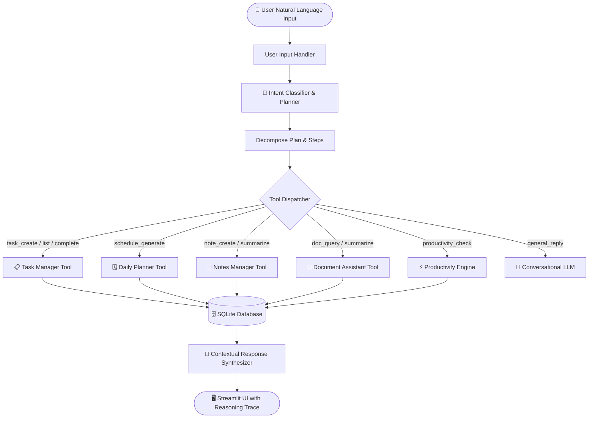

# ⚡ AGENTX – Your AI-Powered Personal Assistant

> **Autonomous Agentic AI • Modular Tool Orchestration • Intelligent Productivity**  
> *Developed for College AI/ML Capstone Presentation & Production-Ready Personal Productivity*

---

## 🌟 Executive Summary

**AGENTX** is a modern, full-stack AI Personal Assistant built in Python and Streamlit. Unlike traditional chatbot interfaces that merely reply with text, AGENTX implements a **genuine Agentic AI Architecture**:
1. **Perceives** user intent in natural language.
2. **Formulates** a step-by-step execution plan.
3. **Selects and dispatches** modular tools (Task Manager, Daily Planner, Notes Manager, Document Assistant).
4. **Executes real database mutations** in SQLite without simulated claims.
5. **Presents a transparent reasoning trace** explaining what actions were performed.

---

## 🏗️ System Architecture



---

## 🚀 Key Modules & Capabilities

### 1. 🤖 AI Chat Assistant (Agentic Hub)
- Natural language multi-turn chat with conversation history stored in SQLite.
- **Agent Reasoning & Execution Trace**: For every action, an expander reveals the identified intent, reasoning, plan steps, and tool execution status.
- **One-Click Quick Demonstration Scenarios** for presentations.

### 2. 📋 Smart Task Manager
- Natural Language Task Extraction: parses commands like *"Finish Machine Learning lab report by tomorrow 4 PM High priority"* into title, priority, due date, and category.
- Priority levels (`High`, `Medium`, `Low`), categories (`Work`, `Study`, `Personal`, `Health`, `Finance`, `Other`).
- Status toggles (Mark Done / Reopen), edit modal, search and filter bar.

### 3. 🗓️ AI Daily Planner
- Automated daily timetable generator: analyzes pending tasks and allocates balanced 60–90 minute focus blocks starting from 09:00 AM, prioritizing critical items.
- Timetable view with status tracking (`planned`, `in_progress`, `completed`).
- Manual custom time block creator and timetable manager.

### 4. 📝 Smart Notes Manager
- Create, edit, and search persistent notes with tags.
- One-click **AI Synthesis**: generates an executive summary and extracts 3–5 actionable key points.

### 5. 📄 AI Document Assistant
- Upload `.txt` and `.pdf` files (extracted via `pypdf`).
- Automatic document summarization upon ingestion.
- Context-aware **Question & Answering** over document contents.

### 6. ⚡ Productivity Assistant
- Real-time productivity score calculation (`completed / total * 100`).
- Priority breakdown and high-priority bottleneck tracking.
- AI-generated daily productivity assessments and actionable next best steps.

### 7. 🛡️ Dual-Mode Engine (Live LLM + Smart Offline Demo Mode)
- **Live Mode:** Powered by Groq’s OpenAI-compatible API (`llama-3.3-70b-versatile`, `llama-3.1-8b-instant`, etc.) for ultra-fast reasoning.
- **Demo Mode:** If no API key is provided, AGENTX automatically falls back to deterministic heuristic parsing and simulation, allowing **100% offline exploration without crashes**.

---

## 🛠️ Technology Stack

| Layer | Technology | Purpose |
| :--- | :--- | :--- |
| **Language** | Python 3.11+ | Core logic and agent orchestration |
| **Frontend UI** | Streamlit | Responsive dark-theme dashboard and multi-view routing |
| **LLM Provider** | Groq API (`llama-3.3-70b-versatile`) | Fast, OpenAI-compatible chat completions and JSON extraction |
| **Client SDK** | `openai` Python SDK | Universal OpenAI-compatible API interface |
| **Persistence** | SQLite (`sqlite3`) | Relational database for tasks, notes, schedules, documents, and chat memory |
| **Document Parsing**| `pypdf` | Multi-page PDF text extraction |
| **Config** | `python-dotenv` | Secure environment variable management |
| **Styling** | Custom CSS (`assets/style.css`) | Glassmorphic cards, gradient accents, modern typography |

---

## 📂 Project Directory Structure

```
personal assistant/
├── app.py                      # Main Streamlit application and page router
├── config.py                   # Environment, LLM configuration, and connection testing
├── requirements.txt            # Python dependencies
├── .env.example                # Example environment variables
├── .env                        # Local environment file (API keys masked)
├── agentx.db                   # SQLite database (auto-generated)
├── README.md                   # Complete documentation
│
├── .streamlit/
│   └── config.toml             # Theme settings and sidebar navigation override
│
├── assets/
│   └── style.css               # Premium dark-theme stylesheet
│
├── modules/
│   ├── __init__.py
│   ├── database.py             # SQLite schema, CRUD operations, and demo seeder
│   ├── ai_engine.py            # Groq API client, prompt templates, and Demo fallback
│   ├── agent.py                # Intent classifier, planner, and tool execution dispatcher
│   ├── task_manager.py         # Task business logic and natural language extraction
│   ├── planner.py              # AI daily schedule generator and timetable management
│   ├── notes_manager.py        # Notes storage, search, and AI synthesis
│   └── document_assistant.py   # PDF/TXT extraction, summarization, and document Q&A
│
└── pages/
    ├── __init__.py
    ├── dashboard.py            # Overview dashboard with metrics, schedule, and activity feed
    ├── assistant.py            # Conversational interface with reasoning trace expander
    ├── tasks.py                # Task management and natural language extraction
    ├── planner.py              # Daily timetable and schedule management
    ├── notes.py                # Smart notes with AI summarization
    ├── documents.py            # Document upload and context Q&A
    └── settings.py             # API configuration, connection test, and demo guide
```

---

## ⚡ Quick Start & Installation Guide

### Step 1: Clone / Navigate to Project Directory
```powershell
cd "c:\Users\MAC\Desktop\clang\New folder\personal assistant"
```

### Step 2: Install Dependencies
```powershell
pip install -r requirements.txt
```

### Step 3: (Optional) Configure Groq API Key
You can get a free, high-speed API key in under 1 minute from [Groq Console](https://console.groq.com/keys).

Edit `.env` or set it directly in the app's **Settings** page:
```env
LLM_API_KEY=gsk_your_actual_groq_api_key_here
LLM_BASE_URL=https://api.groq.com/openai/v1
LLM_MODEL=llama-3.3-70b-versatile
```

> **Note:** If left blank, AGENTX starts in **Demo Mode**, which is fully functional with simulated heuristics!

### Step 4: Run the Application
```powershell
streamlit run app.py
```
The application will launch in your browser at `http://localhost:8501`.

---

## 🎓 College Viva & Presentation Demonstration Guide

When presenting AGENTX to evaluators, follow this recommended 5-minute demonstration sequence:

### 1. The Autonomous Agentic Workflow (Highlight of the Project)
- Navigate to **AI Assistant**.
- Click the demonstration pill: **"🎯 Organize My Day (3 Tasks)"** (or type *"Help me organize my day and create three important tasks"*).
- Show evaluators the **🧠 View Agent Reasoning & Tool Trace** expander:
  - **Intent Identified:** `multi_step_workflow`
  - **Step 1:** Autonomous creation of 3 prioritized tasks
  - **Step 2:** Schedule generation allocating optimal time slots
  - **Step 3:** Database persistence and response synthesis
- Open the **Task Manager** and **Daily Planner** to prove that the tasks and schedule actually exist in the SQLite database!

### 2. Natural Language Task Parsing
- Navigate to **Task Manager**.
- Type: `Prepare presentation slides for AI seminar by tomorrow 5 PM High Priority`.
- Click **AI Extract & Add**.
- Show how the AI extracted the title, due date, category, and assigned `High Priority` with a red accent badge.

### 3. Smart Document Q&A
- Navigate to **Document Assistant**.
- The pre-loaded sample document `AGENTX_System_Specification.txt` is ready.
- Ask: *"What are the main modules of AGENTX?"*
- Observe the context-aware grounded response.

### 4. Technical Architecture Explanation
- Explain the **ReAct (Reason + Act)** pattern implemented in `modules/agent.py`.
- Explain how **SQLite** guarantees offline data ownership and integrity.
- Show how **Groq's LPU inference** provides near-instantaneous latency (<1 second response time) compared to traditional cloud LLMs.

---

## 🔒 Security & Privacy Practices
- **No Hardcoded Secrets:** Credentials are read from `.env` or local session.
- **Key Masking:** API keys are never shown in raw text in the interface (`gsk_...9a1b`).
- **Input Validation:** File upload extensions and inputs are sanitized before database insertion.
- **No Hallucinated Tool Calls:** The agent reports tool execution failures transparently rather than making false claims.

